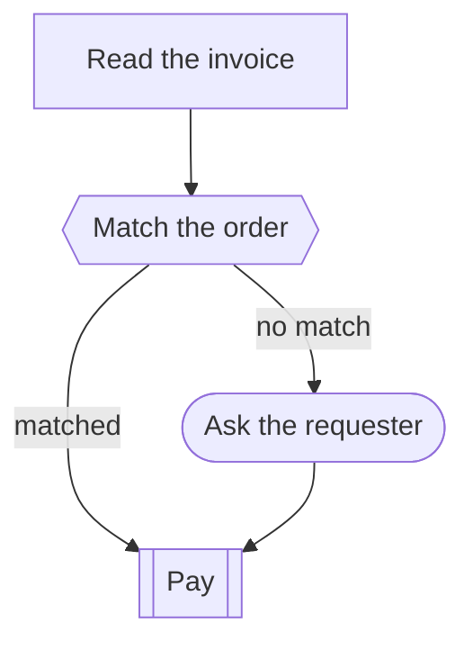

# Skillgram

Write agent skills so their steps form a graph.

Skillgram is a small set of rules on top of the [Agent Skills](https://agentskills.io) `SKILL.md` format. The file stays plain Markdown that people and agents read as prose. Tools read the same text to check it, draw it and diff it.

**[Try the playground](https://oneortwo.github.io/skillgram/)** · **[Read the spec](SPEC.md)**

The playground draws the graph as you type, checks the file against the spec, and lets you add and edit steps visually. Every visual edit is written back to the Markdown.

## What it looks like

```markdown
## Steps

### Read the invoice
Pull the PDF from the email and extract the amount and order number.

### Match the order
After: Read the invoice
Type: gate
Outcomes: matched, no match

Look the order number up. Amounts must agree within 1%.

### Ask the requester
After: Match the order (no match)
Type: human

Ask the person who placed the order to confirm. Wait for their answer.

### Pay
After: Match the order (matched), Ask the requester
Type: skill
Skill: schedule-payment

Pay on the due date.
```



## The rules in short

- Steps live under `## Steps`. Each `###` heading is one step.
- Directives come right under the heading: `After`, `Type`, `Outcomes`, `Skill`, `Until`, `Join`.
- `After:` lists the steps a step waits for. A gate's outcome goes in brackets.
- Exactly one step has no `After:`. That is the start.
- No loops between steps. A retry is `Until:` inside one step.
- Skills opt in with `metadata.skillgram: "0.1"` in the frontmatter.

The full rules and every validator check are in [SPEC.md](SPEC.md).

## Use it

```sh
npm install skillgram
```

```js
import { parse, validate, diff, toMermaid, addStep, updateStep, removeStep } from 'skillgram';
import { render } from 'skillgram/render';

const model = parse(source);          // steps, edges and problems
const problems = validate(source);    // just the problems
const changes = diff(parse(a), parse(b)).changes;
const mermaid = toMermaid(model);
const { svg } = render(model);        // laid out with dagre

// Edit a file without touching the rest of it.
const next = addStep(source, { name: 'Notify', type: 'action', after: [{ name: 'Pay', outcome: null }],
  outcomes: [], skill: null, until: null, join: null, instructions: 'Tell the requester.' });
```

The CLI:

```sh
npx skillgram lint skills/*/SKILL.md      # exits 1 on errors
npx skillgram mermaid SKILL.md
npx skillgram svg SKILL.md > flow.svg
npx skillgram diff old.md new.md          # or --mermaid for a colored diff
```

`skillgram diff --mermaid` prints Mermaid that GitHub draws in PR comments, so a CI job can show how a change moves the flow.

## Status

Draft 0.1. The spec may still change. Open questions are listed at the end of [SPEC.md](SPEC.md).

## Contributing

See [CONTRIBUTING.md](CONTRIBUTING.md).

## License

MIT
